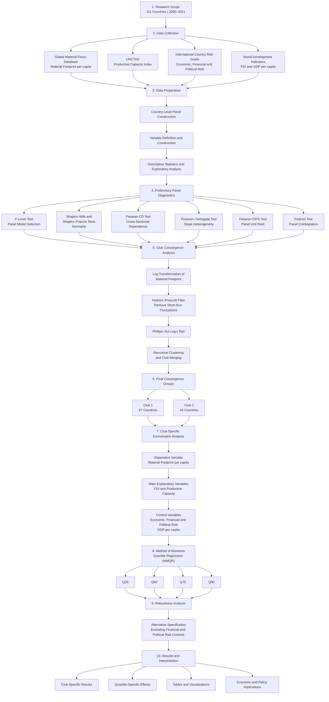

# The Impact of Economic Risk, Financial Risk, and Political Risk on Resource Sustainability

- Method of Moments Quantile Regression and Club Convergence

- A Cross-Country Panel Econometric Analysis Incorporating Foreign Direct Investment and Productive Capacity Factors

## 1. Project Overview

This project is based on my Master's thesis in Economics. It explores how **Foreign Direct Investment** and **Productive Capacity** relate to **Resource Sustainability**, while taking **Economic Risk**, **Financial Risk**, and **Political Risk** into account.

The analysis covers **111 countries from 2000 to 2021**, using Material Footprint per capita as the main measure of resource use.

The project involves:
- Applied econometrics and panel data analysis
- Data collection, cleaning, and analysis
- Econometric testing and diagnostics
- Country-risk and macroeconomic analysis
- Quantitative research and interpretation

📄 **[Read the Full Master's Thesis](thesis/thesis.pdf)**

## 2. Research Question

How are FDI and productive capacity related to resource sustainability across countries, and do these relationships differ depending on country-risk levels, convergence patterns, and material footprint?

## 3. Research Variables

| Variable | Description | Role |
|---|---|---|
| MFP | Material Footprint per capita | Dependent variable |
| FDI | Foreign Direct Investment | Main explanatory variable |
| PCI | Productive Capacity Index | Main explanatory variable |
| ER | Economic Risk | Control variable |
| FR | Financial Risk | Control variable |
| PR | Political Risk | Control variable |
| GDP | GDP per capita | Control variable |

## 4. Data and Empirical Methodology

The following workflow summarizes the main stages of the empirical analysis, from data collection and preparation to econometric estimation and interpretation.

## 5. Econometric Methodology

The empirical strategy combines panel-data diagnostics, convergence analysis, and distributional regression.

### 5.1. Panel Data Diagnostics

Before estimating the main models, the study applies panel econometric diagnostic procedures to assess the properties of the dataset and the suitability of the estimation strategy.

The diagnostic framework includes:

- Cross-sectional dependence testing
- Slope heterogeneity testing
- Panel unit-root testing
- Panel cointegration analysis
- Additional specification and statistical diagnostics

### 5.2. Club Convergence Analysis

Following the Club Convergence framework of Phillips and Sul (2007), the study investigates whether countries share a common long-run convergence path in resource sustainability.

Rather than imposing a single convergence pattern on all countries, the approach identifies groups of countries with similar transition and convergence behaviour.

The final empirical analysis distinguishes two convergence clubs:

| Convergence group | Number of countries |
|---|---:|
| Club 1 | 67 |
| Club 2 | 44 |
| **Total** | **111** |

The identified groups are subsequently analysed separately to account for cross-country heterogeneity.

### 5.3. Method of Moments Quantile Regression (MMQR)

The study applies the Method of Moments Quantile Regression developed by Machado and Silva (2019).

Unlike conventional mean regression, MMQR allows the estimated relationships to vary across different points of the conditional distribution of Material Footprint per capita.

The analysis examines the following quantiles:

**Q25 · Q50 · Q75 · Q90**

This approach provides a more detailed understanding of how FDI, productive capacity, and country-risk indicators relate to resource consumption at different distributional levels.

## 6. Tools and Software

- **Python** — Data cleaning and preprocessing
- **R** — Statistical and econometric analysis (Club Convergence) 
- **Stata** — Panel-data estimation and econometric modelling (Method of Moments Quantile Regression)

## 7. Academic Reference

**Thesis title:**

*Investigating the Impact of Foreign Direct Investment and Productive Capacity on Resource Sustainability: Method of Moments Quantile Regression and Club Convergence*

|---|---:|
| **Author** | Amin Mirhaj |
| **Degree** | M.Sc. in Economics |
| **University** | Ferdowsi University |
| **Supervisor** | Dr. Narges Salehnia |
| **Advisor** | Dr. Fariba Osmani |
| **Year** | 2024 |

📄 **[Read the Full Master's Thesis](thesis/thesis.pdf)**

## Keywords

`Resource Sustainability` · `Foreign Direct Investment` · `Productive Capacity` · `Economic Risk` · `Financial Risk` · `Political Risk` · `Panel Data` · `Club Convergence` · `Method of Moments Quantile Regression`

---

  <em>https://github.com/aminmirhaj/method-of-moment-quantile-regression-econometrics</em>

